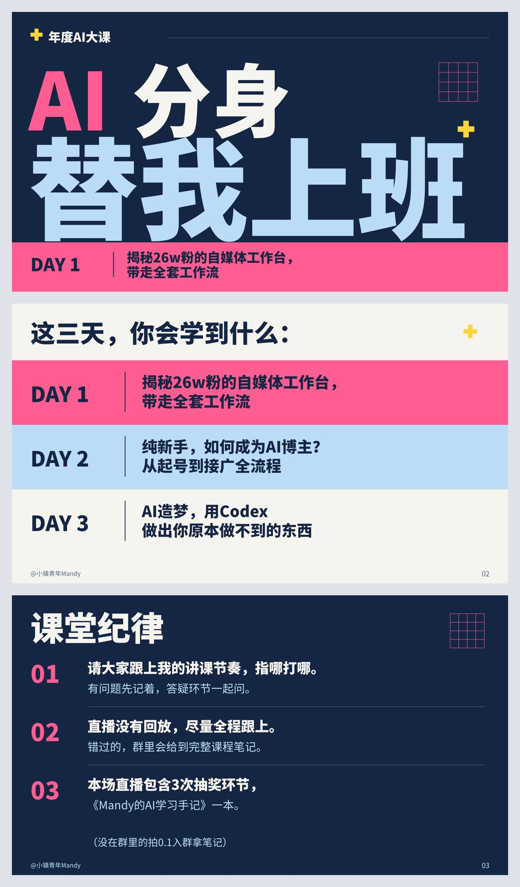

# 红蓝像素设计 · red-blue-pixel-design

Mandy 的红蓝巨字像素风设计 Skill。用深蓝、品牌粉、冰蓝、米白，配合超粗大字、直角色面和少量像素元素，制作海报、直播封面、课程长图、课表、资料图片和 PPT。

## 效果参考

参考图中的人物、课程标题、日期、价格和数字属于历史作品。使用时请提供自己的内容与图片。

## 下载与使用

1. 点击本页 **Code → Download ZIP**，解压完整仓库。
2. 将解压后的文件夹改名为 `red-blue-pixel-design`，保留 `SKILL.md`、`references/`、`assets/` 和 `agents/` 的相对位置。
3. 将完整文件夹交给你使用的 AI Agent，要求它读取 `SKILL.md` 并按说明执行；支持 Skill 安装的客户端也可按该客户端的安装入口导入完整文件夹。

可直接复制的调用示例：

> 用 red-blue-pixel-design，做一张 3:4 直播封面，主题是“普通人怎样用 AI 提高工作效率”，底部写“进来上课”。

> 读取这个 Skill，把我提供的大纲做成红蓝像素风的 16:9 PPT，文字和表格保持可编辑。

> 用红蓝像素风，做一张 9:16 作业说明图，内容如下：……

这是设计规则与素材包。实际生成图片、渲染或导出 PPT，需要所用 Agent 具备相应工具；只下载说明文件不能自动生成成品。不同客户端的安装方式与工具能力可能不同，本仓库不承诺所有客户端均已实测。

## 文件内容

- `SKILL.md`：入口、任务分流、制作和检查要求。
- `references/`：共用风格、海报图片、PPT、样本来源说明。
- `assets/`：色板、CSS、空心像素蝴蝶、参考图片与原生三页 PPT。
- `assets/fonts/`：两款 Noto 字体、版权说明与 Apache 2.0 许可。未分发 Impact。
- `agents/openai.yaml`：Skill 界面配置。

## 参考素材的使用

本仓库经 Mandy 授权公开分享。请将参考作品用于理解设计风格；创作时替换成自己的文案、照片、署名与真实数据。Mandy 的肖像、品牌与历史课程信息不代表对使用者或其产品的背书。第三方字体按随附许可使用，仓库未另行指定统一开源许可证。

公开版已清理本机绝对路径，以及参考 PPT 备注里的内部文档链接、版本号和块 ID；幻灯片内容、布局及图片素材保留。
